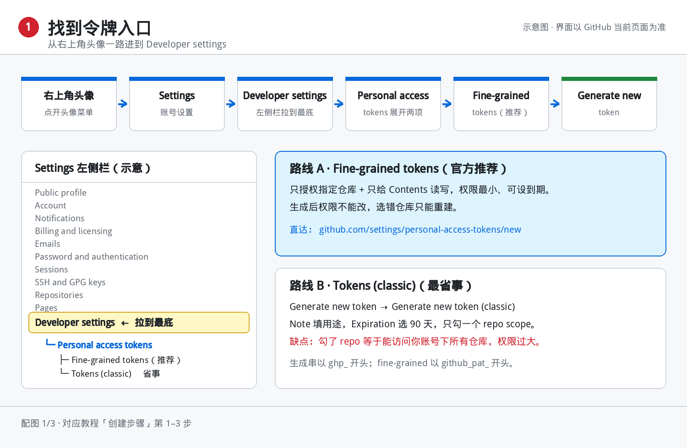
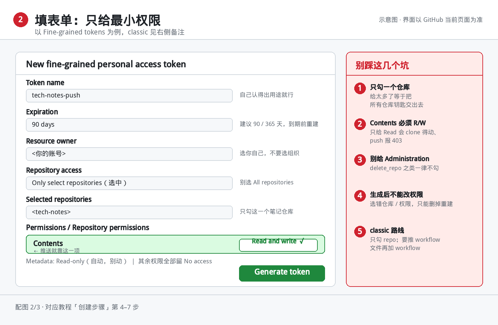
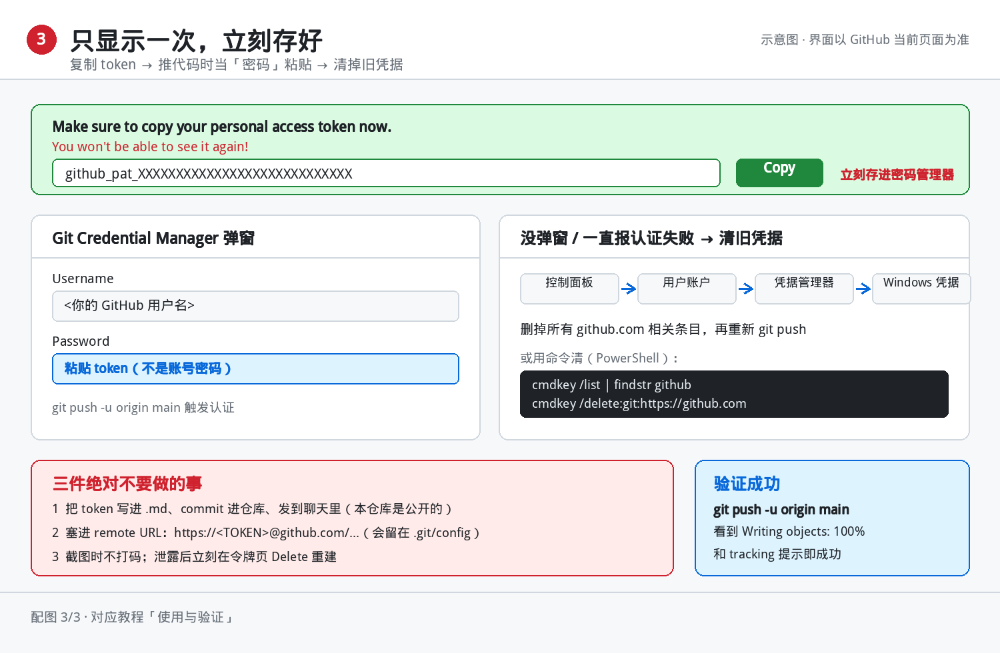

# 创建 GitHub Personal access token（HTTPS 推送用）

> 关键词：`Personal access token`、`PAT`、`github_pat_`、`ghp_`、`repo`、`Contents: Read and write`、`Git Credential Manager`、Windows 凭据管理器、`fatal: Authentication failed`、`Recv failure: Connection was reset`
> 分类：GitHub / 认证 ｜ 首次记录：2026-11-23 ｜ 最后验证：2026-11-23
> 适用环境：Windows 11 + PowerShell + git for Windows，HTTPS 方式推送到公开仓库

## 症状 / 我要解决什么

`git push -u origin main` 时卡在认证：要么不弹窗、要么填了账号密码被拒。GitHub 早已停用 HTTPS 的账号密码认证，命令行要用 **Personal access token（PAT）当「密码」** 才能推。

典型报错：

```
fatal: Authentication failed for 'https://github.com/...'
remote: Support for password authentication was removed on August 13, 2021.
```

## 结论（先写答案）

**先别急着建 token。** 如果 `git push` 时弹出了 Git Credential Manager 的浏览器授权窗口，直接登录 GitHub 就行（官方也优先推荐 GCM 或 `gh auth login`，能用它们就不必创建 PAT）。

只有下面这些情况才需要 PAT：GCM 弹不出来、无浏览器环境、脚本/服务器里要认证、或者旧凭据清不掉。

要建就建 **Fine-grained token**：只授权这一个仓库 + `Contents: Read and write`，90 天到期。生成后**立刻复制**，页面只显示一次。

## ⚠️ 前提

- 账号邮箱已验证（没验证会生成失败）
- 本仓库是 **Public**，生成的网页全网可见 → token 绝不能写进任何 `.md`、截图、commit
- PAT 只能用于 **HTTPS** remote；如果 `git remote -v` 显示 `git@github.com:...`，要先切回 HTTPS

## 两种令牌怎么选

| | Fine-grained tokens（推荐） | Tokens (classic)（省事） |
| --- | --- | --- |
| 路径 | `Fine-grained tokens → Generate new token` | `Tokens (classic) → Generate new token → Generate new token (classic)` |
| 权限范围 | 只勾指定仓库 | 勾 `repo` = 账号下**所有**仓库 |
| 权限粒度 | `Contents: Read and write` | 一整个 `repo` scope |
| 到期 | 可设 90 / 365 天 | 可选 No expiration（不建议） |
| 生成串前缀 | `github_pat_...` | `ghp_...` |
| 生成后改权限 | **不能**，选错只能删掉重建 | 不能 |

## 创建步骤（Fine-grained）

1. 右上角头像 → **Settings**
2. 左侧栏拉到最底 → **Developer settings**
3. **Personal access tokens → Fine-grained tokens → Generate new token**
   直达：`https://github.com/settings/personal-access-tokens/new`



4. **Token name**：`tech-notes-push`（自己认得出用途就行）
5. **Expiration**：`90 days`。到期前重建，顺手记进日历
6. **Resource owner**：选自己（别选组织，组织可能还要审批）
7. **Repository access**：`Only select repositories` → 只勾 `<仓库名>`，**不要选 All repositories**
8. **Permissions → Repository permissions**：
   - `Contents` → **Read and write**（push 就靠这一项，只给 Read 会 403）
   - `Metadata` 会自动变成 Read-only，必带，别动
   - 其余全部留 `No access`
9. 拉到底点 **Generate token**



> **走 classic 路线**：Note 填用途、Expiration 选 90 天、`Select scopes` 只勾 `repo`；如果还要推 `.github/workflows/` 里的文件，再加 `workflow`。其余 `delete_repo`、`admin:org` 一律不勾。

## 立刻复制，只显示一次

生成后页面会写 `Make sure to copy your personal access token now. You won't be able to see it again!`。**当场点 Copy，存进密码管理器**，关掉页面就再也看不到原文，只能 Delete 重建。



## 怎么用在 git 上

```powershell
git push -u origin main
```

弹出的认证窗口里：

- **Username**：你的 GitHub 用户名
- **Password**：粘贴 `<TOKEN>`，**不是账号密码**

Git 会把凭据交给 GCM 缓存，之后不用每次粘贴。

### 没弹窗 / 一直报认证失败 → 清旧凭据

Windows 里旧密码还缓存在凭据管理器，会一直拿它去试：

```
控制面板 → 用户账户 → 凭据管理器 → Windows 凭据
删掉所有 github.com 相关条目，再重新 git push
```

或用命令：

```powershell
cmdkey /list | findstr github
cmdkey /delete:git:https://github.com
```

## 踩过的坑

- **命令行 git 不走浏览器代理**：`Test-NetConnection github.com -Port 443` 显示 `True`，但 `git push` 报 `Recv failure: Connection was reset` → TCP 通了、HTTPS 被掐断，git 在直连。查代理端口后 `git config --global http.proxy http://127.0.0.1:<端口>`（端口别照抄，看代理软件的 HTTP 混合端口）。这是**网络问题，不是认证问题**，别误判成 token 没建好。
- **只给 Contents: Read**：clone 正常、push 报 403。
- **生成后想改仓库**：改不了，删掉重建。
- **token 塞进 remote URL**：`https://<TOKEN>@github.com/...` 会明文留在 `.git/config`，别这么干。
- **凭据已缓存不弹窗**：以为 GCM 坏了，其实是旧密码在复用 → 清凭据管理器。
- **classic 令牌一年没用**：GitHub 会自动删除。

## 验证方式

```powershell
git push -u origin main
```

预期看到 `Writing objects: 100%` 和 `branch 'main' set up to track 'origin/main'`。

## 安全 / 脱敏（本仓库公开，必看）

- token 一律写成 `<TOKEN>`，截图必须打码
- 不写进 `.md`、不 commit、不发聊天、不贴 Issues
- 不塞进 remote URL，不写进脚本明文
- 疑似泄露 → `Settings → Developer settings → Personal access tokens` 里 **Delete**，重新生成
- 到期前重建，别等 push 失败才想起来
- classic 令牌勾了 `repo` 影响面是全部仓库，用完就删

## 关联

- [关键词速查表](KEYWORDS.md)
- [Windows 下写 .md 不跑版的编辑器配置](misc/markdown-editor-setup.md)

## 参考

- GitHub Docs · Creating a personal access token：https://docs.github.com/en/authentication/keeping-your-account-and-data-secure/managing-your-personal-access-tokens
- GitHub Docs · Caching your GitHub credentials in Git：https://docs.github.com/en/get-started/git-basics/caching-your-github-credentials-in-git
- GitHub Docs · Managing your personal access tokens：https://docs.github.com/en/authentication/keeping-your-account-and-data-secure/managing-your-personal-access-tokens
